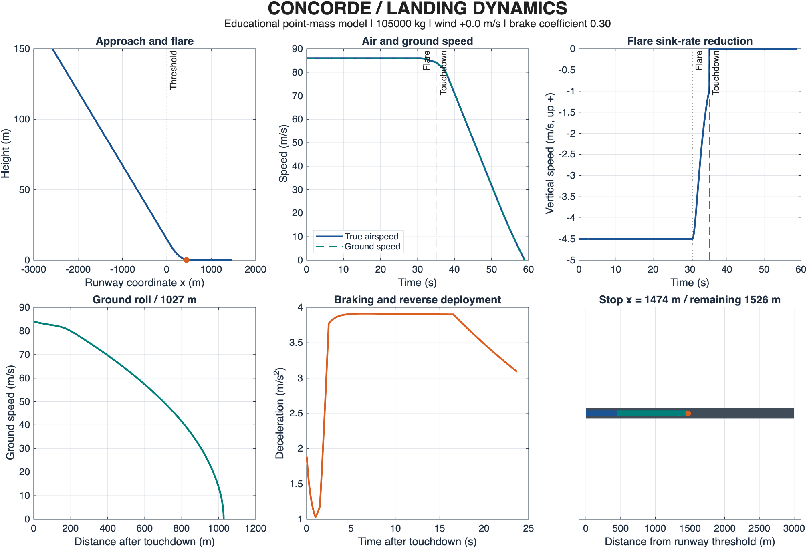
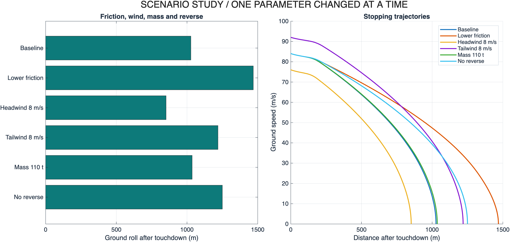

# Concorde & A350 Landing Dynamics Simulator

A MATLAB-first engineering portfolio project: simulate a simplified civilian landing from final approach through flare, touchdown, and ground roll. The emphasis is on transparent equations, repeatable numerical experiments, and test evidence.

**Implemented and tested in MATLAB R2026b. Base MATLAB only; no Simulink, Aerospace Toolbox, or third-party runtime packages.** Intended API baseline is R2023b or later; earlier releases have not been executed here.



## Start here

Open this folder as MATLAB's Current Folder, then run:

```matlab
result = run_demo;         % Simulate, show plots, export results/baseline/
run_tests;                % Analytical, integration and regression checks
run_scenarios;            % Compare six deterministic landing scenarios
landing_app;              % Optional parameter panel with two live result plots
landing_replay;           % Interactive 3D landing replay in base MATLAB
```

In the replay, click **Play** to watch the final approach and landing, or
**Restart** to begin the entire approach. Use the timeline to jump to any
point and switch between chase, cockpit, tower, side profile, nose, overhead,
runway edge, and low approach. Low approach follows the aircraft from a
low front-quarter angle to show the wing underside and extended gear.
Director mode cuts between angles during the landing.
Press 1–9 to select a mode or C to cycle. You can replay
any custom run with `landing_replay(r)`. The aircraft and fictional airfield
are generated in MATLAB, with no external models or scenery downloads.
This is an automatic replay, with illustrative pitch and gear geometry.
The model wears an original, simplified recreation of the
[British Airways Concorde Landor livery](https://mediacentre.britishairways.com/image/details/47327),
including a stylized tail crest; no reference artwork is bundled.
For a desktop graphics smoke check, run `smoke_replay` in MATLAB.

If `local-assets/concorde-cad.bin` is present, the replay uses the
supplied STEP assembly converted to triangles. The CAD mesh shows the
original wing, cockpit glazing, nacelles and extended gear. Its axes
are fitted to nominal Concorde length, span and height independently,
and its main-wheel tread sets the visual contact height. This does not
alter the physics equations or aerodynamic coefficients.
The supplied CAD derivative is excluded from this public repository.
`landing_replay` runs out of the box with the original procedural Landor
aircraft, runway, and nine camera modes. An optional local CAD mesh is
ignored by Git.

To reproduce all included test evidence, CSV data, plots, and the validation report:

```matlab
build_portfolio
```

For a desktop-free batch run, from this directory with MATLAB on your PATH:

```sh
matlab -batch "build_portfolio"
```

Each plotting entry point also accepts an output folder and a visibility flag, for example `run_demo('results/my-run', false)`. `build_portfolio` exports hidden figures and does not open the parameter panel.

## What it models

- A two-dimensional point mass with lift, drag, gravity, thrust, and constant along-runway wind.
- A steady 3-degree approach, then height-based flare guidance using bounded ideal lift/thrust control.
- Event-located flare entry, gear contact, and zero-ground-speed stop using `ode45`.
- A vertical inelastic contact reset, followed by aerodynamic drag, lift unloading, wheel braking, rolling resistance, and reverse thrust.
- Separate true airspeed and ground speed, touchdown sink rate, ground-roll distance, threshold-to-stop distance, runway margin, and sampled control saturation.
- A small interactive MATLAB panel for mass, wind, friction, flare height, reverse force, and runway length.

Concorde supplies the aircraft scale and landing-speed context. The aerodynamic coefficients, controller, brake friction, and reverse-thrust settings are estimates. The project does **not** reproduce certified Concorde performance, pilot technique, landing-gear loads, or operational landing distances. Its scope is ordinary civilian landing; no historical accident is modeled.

## Measured baseline

105,000 kg mass; no wind; 86 m/s approach; flare starts at 12 m; brake coefficient 0.30; 3,000 m runway.

| Quantity | MATLAB result, rounded |
| --- | ---: |
| Touchdown true airspeed | 84.05 m/s / 163.38 kt |
| Touchdown downward speed | 0.97 m/s |
| Touchdown position beyond threshold | 447 m |
| Ground roll after touchdown | 1,027 m |
| Stop position beyond threshold | 1,474 m |
| Remaining modeled runway | 1,526 m |
| Ground-roll duration | 23.72 s |

These are outputs of the chosen model. The [British Airways heritage page](https://www.britishairways.com/content/information/about-ba/history-and-heritage/celebrating-concorde) lists a general Concorde landing speed of 300 km/h. That is scale context, not an acceptance target or a matched test case.

## Change a scenario

```matlab
p = landing.defaultConfig();
p.environment.wind = -8;        % m/s: negative = headwind, positive = tailwind
p.ground.brakeMu = 0.15;        % lower effective friction, not a wet-runway standard
r = landing.simulate(p);
landing.plotResults(r);
landing.exportResults(r, 'results/custom');
disp(r.metrics)
```

The solver rejects missing fields, misspelled fields, nonfinite values, and unsupported configurations. An unfinished approach or ground roll raises a named error rather than reporting a successful stop. A short runway is reported as a negative margin; integration continues to determine the stop position.



## Verification and validation

The checked-in [measured validation report](docs/VALIDATION.md) records the local MATLAB release, test results, and a tighter-tolerance comparison. The suite covers hand-calculated lift/drag, steady-descent balance, an analytical constant-deceleration stop, air/ground energy balance, exact phase transitions, monotonic ground braking, deterministic repeats, friction/wind/reverse trends, solver convergence, input errors, timeouts, and export round trips.

This is equation and software verification with limited physical plausibility checks. Independent Concorde flight-test validation remains open. The [requirements matrix](docs/REQUIREMENTS.md) connects each requirement to code and evidence. The GitHub Actions workflow runs the same build after publication; a successful hosted run is not claimed here.

## Repository map

```text
+landing/              Physics, guidance, events, telemetry, export and plots
tests/testLanding.m    MATLAB function-based unit tests
run_demo.m             Baseline simulation and plots
run_scenarios.m        Six one-at-a-time comparison scenarios
run_tests.m            Test runner, JUnit XML and CSV results
landing_app.m          Optional interactive MATLAB parameter panel
landing_replay.m       Interactive 3D replay and instrument readouts
build_portfolio.m      One-command reproduction of the portfolio evidence
docs/                  Equations, assumptions, provenance and test traceability
results/baseline/      PNG plots, CSV telemetry, JSON configuration/metrics, MAT
results/scenarios/     Comparison chart, CSV and complete run data
results/verification/  JUnit XML and individual test results
.github/workflows/     MATLAB test and artifact build workflow
```

Start with [MODEL.md](docs/MODEL.md) for derivations and sign conventions, [PARAMETERS.md](docs/PARAMETERS.md) for every parameter and its provenance, and [PORTFOLIO.md](docs/PORTFOLIO.md) for an engineering walkthrough. See [ATTRIBUTION.md](ATTRIBUTION.md) for AI assistance and source-use disclosure. Code is available under the [MIT License](LICENSE).

## A350 sunset replay and native C++17 backend

Run `aircraft_selector` to choose the Concorde or the A350 (day or sunset). `run_a350` opens the sunset replay; `export_a350_video` records an MP4. The A350 configuration is a simplified educational estimate, not certified aircraft performance. The public repository uses an original illustrative procedural airliner model. For the optional colored CAD replay, provide a licensed OBJ/MTL and convert it with `python3 convert_a350.py path/to/model.obj local-assets/a350-cad.bin` (the loader expects the project's 300 mm source coordinate convention). Local CAD meshes and reference imagery are excluded from GitHub.

With a supported C++ compiler, run `build_native` from MATLAB to build the MEX module; then `run_tests`. MATLAB calls the C++17 force calculations for approach, flare and ground roll; the MATLAB equations remain a fallback. The standalone C++ core tests passed and the MEX source passed compiler syntax checking; the MEX runtime build still requires verification. Sunset CAD replay was opened successfully in MATLAB R2026b. Standalone C++ test: `c++ -std=c++17 -O2 native/test_core.cpp -o /tmp/landing_native_test && /tmp/landing_native_test`.
